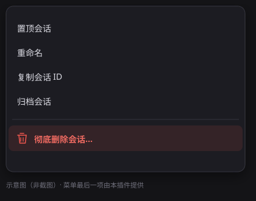
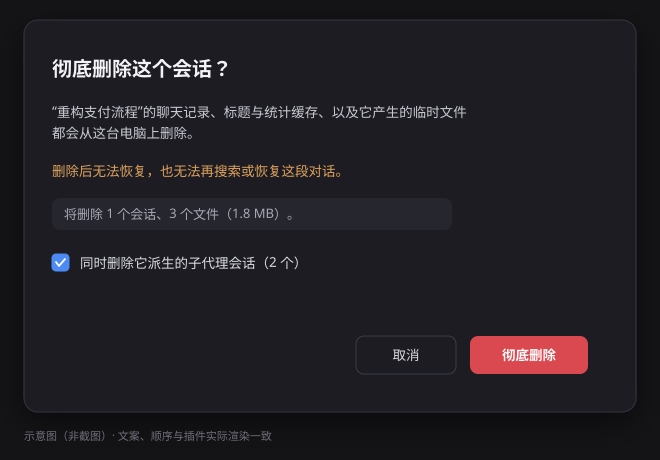

# dsh-session-delete · 彻底删除会话

给 DeepSeek Harness 的会话右键菜单加一项 **“彻底删除会话…”**：把一段对话在这台电脑上留下的所有东西真正删掉，而不只是从列表里隐藏。

DSH 自带的是 **归档**（Archive）：会话行消失，但 `session.v4.jsonl.zstd` 完整保留在磁盘上，随时可以取消归档读回来。本插件补上“删除”这一档。

## 界面

<p>
  
  &nbsp;&nbsp;
  
</p>

菜单项排在“归档会话”之后、单独一组；确认框会实时读取待删文件清单（会话数、文件数、体积），并在有多级子代理时给出是否连带的勾选。上面两张是示意图，配色、文案与顺序与插件实际渲染一致。

## 删除什么

确认框里点“彻底删除”后，对目标会话（勾选时还包括它派生的子代理会话）依次做四件事：

| 步骤 | 动作 | 说明 |
| --- | --- | --- |
| 1 | 停止并隐藏 | 调 Workspace 注册表的 `archiveSession(id, { stopActivity: true })`，停掉正在跑的回合、子代理、后台任务与定时器，把会话行移出所有分组视图 |
| 2 | 删聊天记录 | 删掉 `$DSH_HOME/sessions/<项目目录>/<会话 id>/`，即 `session.v4.jsonl.zstd` 与其同目录文件 |
| 3 | 删派生数据 | 删掉 `$DSH_HOME/storages/session_projcache/sessions/<会话 id>.json`（标题、标题候选、token 统计、回合大纲等） |
| 4 | 删临时文件 | 删掉 `%TEMP%/dsh-spill-*/session-<sha256(id)[:12]>/` 下的工具输出溢出文件 |

删完再扫一遍，并在约 6 秒后再扫一次（投影缓存有 5 秒的写回窗口，晚到的检查点不会把记录重新写出来）。若某个文件正被占用导致删不掉，接口会把失败清单返回给界面，提示“重启应用后重试”。

删除 **不** 依赖“回收站”，也不发送任何网络请求；全部是本机文件系统操作。

## 子代理会话

默认勾选“同时删除它派生的子代理会话”。规则：

- 只沿着 `origin: "subagent"` 的 `parentSession` 链向下展开（含多级）；
- **分叉（fork）不会被连带删除**——分叉是一段独立对话，`origin` 为空；
- 取消勾选时只删你点的那一个会话。

## 安装

已安装到桌面应用的 `desktop` 配置：

```
%USERPROFILE%\.dsh\profiles\desktop\package.json
  dependencies:  "dsh-session-delete": "link:<本目录>"
  dsh.profile.bundles: [ ..., "dsh-session-delete" ]
```

> **这个目录不能删，也不能改名。** 安装用的是 `link:`，运行中的应用直接从 `<本目录>` 读代码；目录消失后插件从下次启动起失效（应用本身仍能启动，只是这一行会被跳过，菜单项消失）。要搬到别处，先移动目录，再从新位置运行 `install.ps1` 重新链接。

**需要重启一次桌面应用**：插件行是在应用启动时按 `dsh.profile.bundles` 组合进 profile 的，新装的 bundle 不会被当前进程热加载（配置文件的热更新只重建已有的 bundle 列表，不会导入新包）。重启后：

1. 访问 `http://127.0.0.1:<端口>/.dsh-session-delete/health` 应返回 `{"ok":true,...}`（端口以应用实际 URL 为准）；
2. 侧栏会话行右键 → 菜单最后一项出现“彻底删除会话…”。

卸载：从 `dependencies` 与 `dsh.profile.bundles` 中删掉 `dsh-session-delete`，再执行 `pnpm install` 并重启。

## 分享给别人

插件是自包含的 npm 包：无运行时依赖、无构建步骤，`index.js` / `client.js` / `lib/` / `cordis.patch.yml` 直接可用。

仓库：<https://github.com/HHHHHH233333/dsh-session-delete> —— 在 DSH 的插件管理里填这个地址即可安装。

三种给法：

**A. 直接给文件夹（最省事）**
把整个 `dsh-session-delete` 目录压缩发过去。对方解压后在该目录里运行：

```powershell
powershell -ExecutionPolicy Bypass -File .\install.ps1
```

脚本会：备份他的 profile → 写入 `link:<解压目录>` 依赖 → 把 `dsh-session-delete` 追加进 `dsh.profile.bundles` → 用 DSH 自带的 node/pnpm 安装 → 校验能否解析，最后提示重启。可重复执行；先加 `-DryRun` 只预览不落盘，`-Profile` / `-DshHome` 可指定其他 profile 或主目录。

**B. 给一个 tarball**
直接从 [Releases](https://github.com/HHHHHH233333/dsh-session-delete/releases/latest) 下载 `dsh-session-delete-0.1.0.tgz`，或本地用 `pnpm pack` 重新打（只含 `files` 里列的文件，`test/` 不会打进去）。对方在插件管理里安装本地包，或手动：

```powershell
pnpm add .\dsh-session-delete-0.1.0.tgz
```

然后把 `dsh-session-delete` 加进 `dsh.profile.bundles` 并重启。

**C. 从仓库装（推荐给熟悉 DSH 的人）**
在 DSH 的插件管理里填仓库地址 `https://github.com/HHHHHH233333/dsh-session-delete`，管理器会 clone 并执行 pnpm 安装、自动把这个 bundle 加进 profile。

**D. 发到 npm**
先把 `package.json` 里的 `"private": true` 改成 `false`，再 `npm publish`。无前缀的 `dsh-session-delete` 可能已被占用，必要时改成 `@你的scope/dsh-session-delete`——插件行 id 就是包名，改名后 `dsh.profile.bundles` 里的条目和 `link:` 路径都要跟着改。

**对方需要什么**：桌面版或 web profile 的 DSH（`@deepseek-ai/dsh-base` 提供 `webServer` / `workspaceRegistry` / `sessionPersistence`，本插件依赖这三个服务）；装完必须重启应用。

## 使用

1. 右键侧栏里的会话（或它的 “…” 菜单）。
2. 选 **彻底删除会话…**（排在“归档”和“复制会话 ID”之后，带分隔线）。
3. 确认框会显示：会话标题、将删除的会话数与文件数、是否包含子代理。
4. 点 **彻底删除**。界面提示成功后，该会话行从列表消失，磁盘上不再有它的记录。

删除当前正在使用的会话同样会成功：会话行消失，当前视图随之失效。请自行确认这是你要的结果。

## 配置（可选）

在 `cordis.patch.yml` 里给这一行加 `config` 即可覆盖默认值：

```yaml
- id: dsh-session-delete
  config:
    sessionsRoot: D:\dsh\sessions   # 默认 $DSH_HOME/sessions
    dshHome: D:\dsh                 # 默认 $DSH_HOME，其次 ~/.dsh
    spillRoots: [D:\temp\dsh-spill] # 额外的溢出根目录；系统临时目录总会扫描
    settleMs: 1200                  # 停止后等待多久再删文件
    lateSweepMs: 6000               # 后台补扫延迟；0 关闭
```

## HTTP 接口

仅供本机界面调用（服务只监听回环地址，跨站 `Origin` 会被拒绝，`sessionId` 必须是单个安全路径段）：

- `GET  /.dsh-session-delete/health`
- `GET  /.dsh-session-delete/preview?sessionId=<id>&subagents=1`
- `POST /.dsh-session-delete/delete`，body `{ "sessionId": "<id>", "deleteSubagents": true }`

`preview` 只统计不删除；`delete` 返回 `{ ok, found, targets, artifacts, files, bytes, complete, failures }`。

## 已知边界

- **共享附件**：内容寻址的附件/图片仓库是跨会话共享的，不属于某一个会话，因此不会被删除。
- **工作区成员表**：`storages/workspace.json` 的 `sessionIds` 里会留下一个指向已删会话的 id。没有公开 API 可以移除成员，且该 id 不可见（没有会话头就不再渲染）。插件在**下次启动时**会清理 `archivedSessionIds` / `pinnedSessionIds` 中已不存在的 id。
- **归档 id 的保留**：删除后故意不立即取消归档，否则正在运行的界面会把该行重新显示出来；清理放在下次启动。
- **搜索索引**：当前构建的会话检索使用 `:memory:` 数据库、从不落盘，因此没有需要清理的索引文件；若未来开启持久索引，需要补一条清理路径。
- **文件占用**：Windows 上若某个文件被子进程占用，删除会失败并回报清单；关闭相关任务或重启应用后再删一次。
- **其它机器的副本**：本插件只处理本机文件，不影响任何远端备份。

## 开发与测试

```
node --test test/*.test.mjs
```

- `purge.test.mjs`：路径编码、日志/缓存/溢出目录删除、空项目目录回收、幂等性；
- `service.test.mjs`：目标展开（含子代理、排除分叉）、归档调用、HTTP 路由、启动清理；
- `client.test.mjs`：客户端模块装配、两个插槽、确认框/菜单项渲染与预览请求；
- `cordis.test.mjs`：在真实 Cordis 上下文里挂载 Host 半边，验证路由注册、健康检查与卸载。找不到运行时时自动跳过；需要手动跑时，用 `DSH_CORDIS_ENTRY` 指向任意 `@deepseek-ai/cordis` 的 `lib/index.js` 即可。

## 文件

```
index.js              Host 入口：注入服务、注册前缀路由、启动清理
lib/service.js        编排：展开目标 → 停止 → 删除 → 补扫；preview / delete / health
lib/purge.js          纯文件系统层：定位与删除日志、缓存、溢出目录
client.js             浏览器半边：菜单项 + 确认框 + 提示
cordis.patch.yml      bundle 补丁层（插入一行）
locale/{zh,en}.json   插件元信息
icon.svg              图标
install.ps1           给别人的一键安装脚本（备份 / 写依赖 / 装依赖 / 校验）
test/*.test.mjs       单元与集成测试
```

MIT。